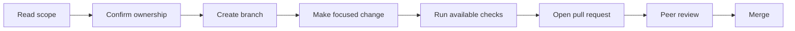
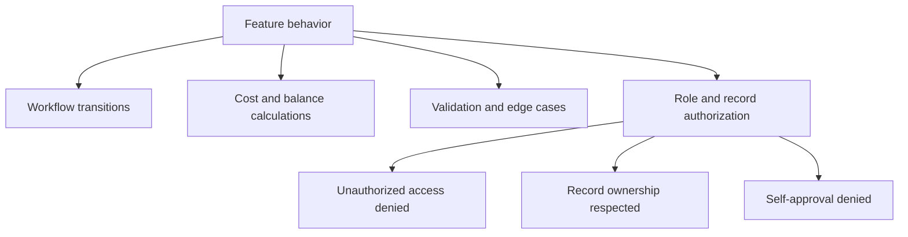

# Contributing to ProjectOps

<div align="center">

**Small changes, clear reviews, traceable implementation**

[Project overview](README.md) · [Documentation](docs/README.md) · [Requirements](docs/project-overview-and-requirements.md) · [Workflows](docs/workflows-and-business-rules.md)

<br/>


</div>

> [!IMPORTANT]
> ProjectOps is a team internship project. Coordinate changes that affect shared models, role permissions, workflows, calculations, or documentation before implementation.

---

## Contribution workflow



Every contribution should move the repository toward:

- A clear and accurate implementation
- Reviewable model and view changes
- Server-side security enforcement
- Evidence-based documentation
- Testable business behavior

---

## Before you start

### 1. Read the project context

- [Repository overview](README.md)
- [Documentation index](docs/README.md)
- [Project requirements](docs/project-overview-and-requirements.md)
- [Workflows and business rules](docs/workflows-and-business-rules.md)
- [Architecture and data design](docs/system-architecture-and-data-design.md)

### 2. Confirm the work

Before editing:

- Confirm the task and primary owner with the team.
- Identify requirements or architecture decisions affected by the change.
- Check whether a shared model or interface contract is involved.
- Review the actual repository status rather than assuming a planned feature exists.
- Raise unresolved decisions before silently choosing product behavior.

### 3. Keep the change focused

Avoid mixing unrelated changes such as:

- Security changes with an unrelated UI refresh
- Model migrations with documentation cleanup
- One feature's implementation with another feature's design
- Formatting changes across files unrelated to the pull request

---

## Working with branches

Use a short, descriptive branch name that identifies the work area:

| Change type | Example branch |
|:--|:--|
| Documentation | `docs/readme-refresh` |
| Feature | `feature/project-model` |
| Bug fix | `fix/menu-action` |
| Tests | `test/worklog-approval` |
| Security | `security/project-record-rules` |
| Configuration | `chore/module-foundation` |

Recommended prefixes:

```text
feature/
fix/
docs/
test/
security/
chore/
refactor/
```

Avoid committing unrelated work to the same branch.

---

## Commit messages

Use the conventional commit style:

```text
<type>: <short imperative description>
```

### Common types

| Type | Use |
|:--|:--|
| `feat` | Add a new feature or model |
| `fix` | Correct existing behavior |
| `docs` | Improve documentation |
| `test` | Add or update tests |
| `refactor` | Improve structure without changing behavior |
| `chore` | Update repository maintenance or tooling |
| `security` | Improve access control or authorization |

### Examples

```text
docs: clarify project scope
feat: add project model
fix: correct menu action
test: cover worklog approval rules
security: add project record rules
```

Keep each commit focused on one logical unit of work.

---

## Pull request checklist

Before requesting review:

- [ ] The change matches an agreed requirement or clearly documents a proposed decision.
- [ ] The implementation, documentation, and tests do not contradict each other.
- [ ] Shared model or field names were communicated to affected team members.
- [ ] Generated bytecode, local database files, secrets, and unrelated files are excluded.
- [ ] New or changed permissions are enforced in server-side logic.
- [ ] UI changes include screenshots or a clear description of the result.
- [ ] The pull request explains test results or why tests could not run.
- [ ] Known limitations are identified explicitly.

### Pull request description

Provide:

```markdown
## Summary

What changed and why.

## Files or areas affected

- `path/to/file`
- `path/to/another-file`

## Requirements or design impact

Which agreed behavior or proposed decision changed.

## Validation

- Test command or manual scenario
- Result
- Remaining limitation

## Screenshots

Include only real application screenshots.
```

Ask a teammate to review the change before merging. A passing commit or a local build is not by itself proof that a feature is complete.

---

## Documentation changes

Documentation should describe both intended and implemented behavior accurately.

### Keep status explicit

- Label proposed behavior as **planned**.
- Do not claim a feature is implemented until its code is reviewed.
- Describe unresolved decisions rather than silently inventing behavior.
- Update the README and implementation status as functionality is added or materially changed.
- Keep requirements, architecture, workflows, and code synchronized.

### Documentation areas

| Documentation | Update when |
|:--|:--|
| README | Installation, maturity, feature status, or repository structure changes |
| Requirements | Scope or functional expectations change |
| Architecture | Models, dependencies, relationships, or platform decisions change |
| Workflows | States, approvals, calculations, or validation rules change |
| Project plan | Responsibility, roadmap, risk, or handover scope changes |

---

## Testing

The repository currently has no automated test suite or canonical test command.

When executable functionality is added:

1. Use the appropriate Odoo test infrastructure.
2. Add focused tests for the behavior being implemented.
3. Document the exact test command and environment.
4. Include test results in the pull request.
5. State explicitly if tests could not run.

### Required test categories



Priority test areas include:

- Server-side role and record authorization
- Worklog and expense submission and approval
- Rejection and correction behavior
- Prevention of self-approval
- Approved-cost calculations
- Historical hourly-rate snapshots
- Budget utilization
- Partial payments and outstanding balances
- Project completion independently of invoice settlement
- Missing values, invalid inputs, and financial edge cases

Do not add tests that only repeat implementation constants or assert that a framework field type exists.

---

## Security-sensitive changes

Changes involving roles, project visibility, approvals, worklogs, expenses, billing, or payments require particular care.

Security requirements include:

- Enforcing permissions on the server, not by hiding buttons or menus
- Testing unauthorized direct access
- Preventing users from approving their own submissions
- Protecting project costs and billing from unauthorized roles
- Recording approver identity and decision timestamps
- Avoiding sensitive values in logs or screenshots
- Reviewing record rules alongside model access rights
- Testing the complete role matrix with separate accounts

See [Workflows and business rules](docs/workflows-and-business-rules.md) for the intended security and approval rules.

---

## Data and environment safety

Do not commit:

- Database dumps
- Local configuration files
- Generated Python bytecode
- Secrets or credentials
- Private customer or employee records
- Attachments containing sensitive information
- Screenshots exposing financial or personal data

Use fictional demonstration data and an isolated development database.

---

## Review responsibilities

### Contributor

- Explain the change and its scope.
- Provide validation evidence.
- Resolve or document unclear requirements.
- Respond to feedback with focused updates.

### Reviewer

- Check the requirements and implementation align.
- Look for server-side security gaps.
- Verify calculations and edge cases.
- Confirm documentation reflects actual behavior.
- Ensure no unrelated or sensitive files are included.

No one should merge a change that is known to break the shared workflow or weaken authorization.

---

## Current limitations

This guide establishes initial team conventions. The project does not yet have:

- A verified installation procedure
- A canonical test command
- A CI pipeline
- A formal release process
- A supported-version policy
- A security-reporting contact
- Issue or pull-request templates

These items should be added as implementation and release maturity progress.

---

<div align="center">

[Back to the repository README](README.md) · [Open the documentation index](docs/README.md)

<sub>ProjectOps · Keradion Technology</sub>

</div>
