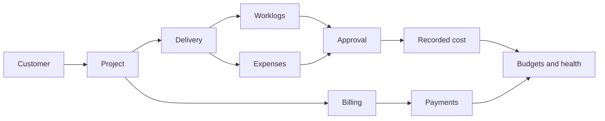
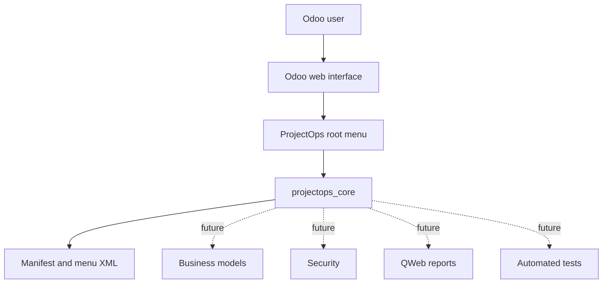
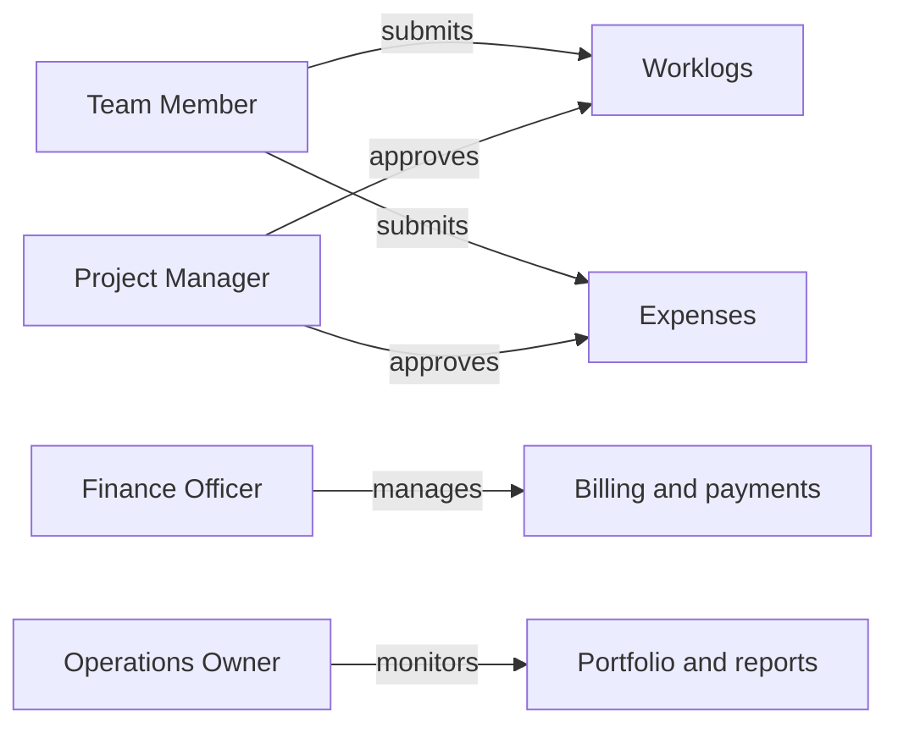
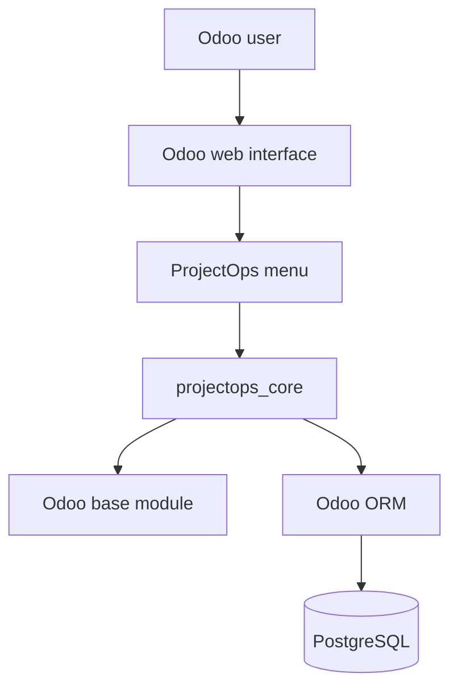
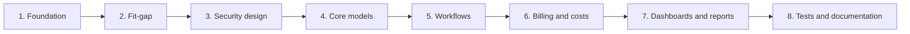

# ProjectOps

<div align="center">

**Project delivery and project-level financial visibility for Odoo**

<sub>Odoo 19 Community · Python · PostgreSQL · XML · QWeb</sub>

<br/>

[Overview](#overview) · [Implementation status](#implementation-status) · [Architecture](#architecture) · [Getting started](#getting-started) · [Documentation](#documentation) · [Roadmap](#roadmap)

<br/>


</div>

> [!WARNING]
> **The ProjectOps MVP is not implemented yet.**
>
> This repository contains an Odoo add-on skeleton and a requirements baseline. Customer, project, worklog, expense, billing, dashboard, reporting, and security capabilities described here are planned unless specifically identified as implemented.

---

## Overview

ProjectOps is being designed as an integrated, Odoo-based operational system for service businesses.

It connects delivery information with project-level financial visibility:



The initial scope is Keradion Technology's internal operations, with an architecture intended to remain reusable for other small and medium-sized service businesses.

ProjectOps is **not** a complete accounting, payroll, HR, procurement, or inventory system.

---

## Implementation status

The repository is at a **module-foundation and requirements** stage.

| Component | Status | What exists |
|:--|:--:|:--|
| Odoo add-on metadata |  | Installable manifest with application and version metadata |
| ProjectOps navigation |  | One top-level menu item |
| Custom models |  | No Python models are present |
| XML views |  | A menu declaration only |
| Security groups and record rules |  | No security configuration exists |
| Access control CSV |  | No model access rights are defined |
| Customer and project management |  | Requirements and proposed architecture only |
| Tasks and milestones |  | Requirements and proposed architecture only |
| Worklogs and approvals |  | Business rules defined; implementation absent |
| Expenses and approvals |  | Business rules defined; implementation absent |
| Costs and budget utilization |  | Calculations are specified only in documentation |
| Billing and payments |  | Requirements exist; no invoice or payment models |
| Dashboards and health |  | Target metrics are documented but not implemented |
| PDF reports |  | No QWeb report exists |
| Automated tests |  | No test suite or test command exists |

### Current module boundary



The solid connection represents code that exists today. Dashed connections represent planned additions, not implemented functionality.

---

## Target MVP

The following is the intended product surface. Treat every item as a requirement until its model, view, security, and tests are present.

| Delivery | Financial operations | Management visibility |
|:--|:--|:--|
| Customers and projects | Approved labour costs | Project cost summary |
| Project ownership | Approved expense costs | Budget utilization |
| Milestones and tasks | Historical hourly-rate snapshots | Outstanding balances |
| Team assignments | Invoice records | Transparent project health |
| Worklog submission | Partial customer payments | Portfolio monitoring |
| Approval traceability | Estimated project contribution | Printable project reports |

### Intended roles



| Role | Intended responsibility |
|:--|:--|
| Owner / Operations Manager | Portfolio oversight, progress, budgets, and outstanding balances |
| Project Manager | Delivery management, assignments, and authorized submission review |
| Finance Officer | Billing, payment tracking, and financial record management |
| Team Member | Assigned work and worklog or expense submission |

Customer-facing portal access is outside the current scope.

---

## Core business rules

These rules are requirements for implementation, not statements of current behavior.

| Rule | Required interpretation |
|:--|:--|
| Approved labour only | Pending and rejected worklogs must not contribute to recorded cost |
| Approved expenses only | Pending and rejected expenses must not contribute to recorded cost |
| No self-approval | A user must not approve their own worklog or expense |
| Historical cost integrity | Worklogs must preserve the applicable hourly-rate snapshot |
| Partial payments | Multiple payments may apply to an invoice |
| Outstanding balance | Invoice amount minus payments received |
| Independent completion | Project completion must not depend on full invoice settlement |
| Explainable health | Every health indicator must expose its triggering rule |
| Contribution terminology | Use estimated project contribution, never net profit |
| Sensitive access | Protect financial records with server-side authorization |

Unresolved workflow, reversal, rounding, refund, threshold, and role-authority decisions are tracked in the project documentation.

---

## Architecture

### Implemented repository architecture



The module currently contains:

```text
projectops_core/
├── __manifest__.py
├── __init__.py
└── views/
    └── menu_views.xml
```

No custom Python models, security rules, report actions, controllers, wizards, tests, or frontend assets exist yet.

### Intended platform

| Technology | Role |
|:--|:--|
| Odoo 19 Community | ERP framework and native web interface |
| PostgreSQL | Persistent application database |
| Python | Custom Odoo models and server-side logic |
| XML | Menus and native Odoo views |
| QWeb | Planned printable reports |
| Odoo ORM | Planned model relationships and database access |

The architecture documents propose reusable native models including `res.partner`, `project.project`, `project.task`, `account.analytic.line`, `hr.expense`, `account.move`, and `account.payment`. The native-versus-custom mapping and required app dependencies have not been finalized.

---

## Repository structure

```text
projectOps/
├── README.md
├── .gitignore
├── docs/
│   ├── project-overview-and-requirements.md
│   ├── project-plan-and-team-governance.md
│   ├── system-architecture-and-data-design.md
│   └── workflows-and-business-rules.md
└── projectops_core/
    ├── __init__.py
    ├── __manifest__.py
    └── views/
        └── menu_views.xml
```

This tree reflects the repository as it exists, not the planned future module layout.

---

## Getting started

> [!NOTE]
> A verified installation guide does not exist yet.

The project targets **Odoo 19 Community** and **PostgreSQL**, but the repository has not yet documented or validated the exact supported Python version, PostgreSQL version, addons path, server configuration, database initialization, or test command.

### Generic prerequisites

- Odoo 19 Community
- PostgreSQL
- Python compatible with the selected Odoo 19 environment
- A local Odoo addons directory

Exact versions and operating-system setup remain to be confirmed.

### Generic installation concept

The module must be discoverable through the Odoo server's configured addons path:

1. Place `projectops_core` in a discoverable addons directory.
2. Add that directory to the Odoo `addons-path` configuration.
3. Restart the Odoo server.
4. Update the Apps list.
5. Install **ProjectOps**.

These are standard Odoo procedure steps, not commands already verified by this repository.

---

## Testing

No automated test suite or repository-defined test command currently exists.

The implementation will need tests covering, at minimum:

- Server-side role and record authorization
- Worklog submission, approval, rejection, and correction
- Expense submission, approval, rejection, and correction
- Prevention of self-approval
- Approved-cost calculations
- Historical hourly-rate snapshots
- Budget utilization and zero or missing budgets
- Partial payments and outstanding balances
- Reversals and other finalized financial adjustments
- Project completion independently of invoice settlement

CI and coverage badges should be added only after those systems exist.

---

## Documentation

| Product and scope | Architecture and workflow |
|:--|:--|
| [Project overview and requirements](docs/project-overview-and-requirements.md) | [System architecture and data design](docs/system-architecture-and-data-design.md) |
| [Project plan and team governance](docs/project-plan-and-team-governance.md) | [Workflows and business rules](docs/workflows-and-business-rules.md) |

These documents are design materials unless explicitly described otherwise.

Future documentation should include:

- Verified installation and configuration
- Developer environment setup
- Implemented data model and field reference
- Security and role-permission matrix
- User workflows
- Test plan and test execution
- Deployment and upgrade procedures
- Demo data and acceptance evidence

---

## Roadmap



| Phase | Priority |
|:--|:--|
| Foundation | Confirm Odoo, Python, PostgreSQL, and required app dependencies |
| Fit-gap | Decide native reuse, inheritance, configuration, and custom models |
| Security | Finalize roles, groups, record rules, and approval authority |
| Core | Implement customer, project, task, milestone, and assignment models |
| Workflows | Implement worklog and expense submission and approval |
| Financial | Implement approved costs, budgets, invoices, and payments |
| Visibility | Add dashboards, health indicators, and printable reports |
| Quality | Add test evidence, setup validation, demo data, and CI |

---

## Scope boundaries

The current scope does not include:

- Full accounting or tax management
- Payroll or full HR management
- Procurement or inventory management
- Payment gateway integration
- A separate React or mobile frontend
- AI-driven approval or operational decisions
- Customer-facing portal access

---

## Screenshots

No application screenshots are available yet.

Real interface screenshots should be added only after stable ProjectOps views exist. They will show:

- Project overview
- Delivery and assignments
- Approval workflow
- Financial summary
- Role-restricted records

No mock or AI-generated product screen should be presented as the implementation.

---

## Contributing

ProjectOps is a Keradion Technology team project. Coordinate shared model, security, workflow, and documentation changes through review rather than working in isolation.

The repository does not yet include:

- A contribution guide
- A code of conduct
- Issue or pull-request templates
- CI checks
- A release process
- A security reporting policy

---

## License

The module manifest declares **LGPL-3**, but a canonical repository-level `LICENSE` file is not currently present. Licensing should be confirmed before the repository is treated as formally published.

---

<div align="center">

**ProjectOps** — *Keradion Technology*

<sub>Requirements and module foundation · Implementation in progress</sub>

</div>
