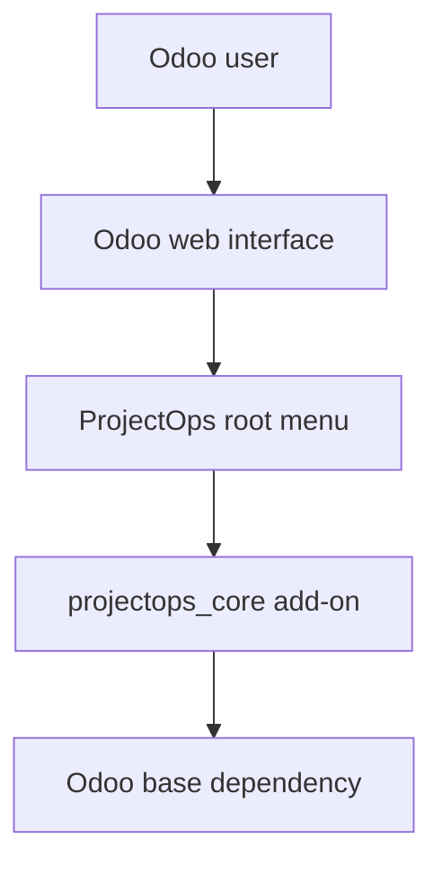

<div align="center">

# ProjectOps

### Project delivery and project-level financial visibility for Odoo

**An Odoo 19 Community add-on in early development**

[Overview](#overview) · [Current status](#current-status) · [Architecture](#architecture) · [Documentation](#documentation) · [Roadmap](#roadmap)

</div>

---

> **Project status: Pre-implementation**
>
> This repository currently contains an installable Odoo add-on skeleton and project documentation. The business features described below are planned requirements, not implemented functionality. Do not use this repository as a production project-management or financial system.

## Overview

ProjectOps is an intended Odoo-based system for connecting project delivery information with project-level financial visibility. It is being developed initially for internal use at Keradion Technology, with a design that may be reusable by small and medium-sized service businesses.

The project aims to bring project records, delivery progress, approved worklogs and expenses, budgets, billing, payment tracking, and operational reporting into one workflow.

ProjectOps is **not intended to replace full accounting, payroll, human resources, procurement, or inventory systems**.

## Current status

The current codebase is at an early skeleton stage:

| Area | Current state |
|---|---|
| Odoo add-on metadata | Present |
| ProjectOps root menu | Present |
| Custom business models | Not implemented |
| Customer and project management | Planned |
| Tasks, milestones, and assignments | Planned |
| Worklogs and approval workflows | Planned |
| Expense submission and approvals | Planned |
| Budget and cost calculations | Planned |
| Billing and payment tracking | Planned |
| Dashboards and project health indicators | Planned |
| PDF project reports | Planned |
| Custom security groups and record rules | Not implemented |
| Automated tests | Not implemented |
| CI/CD and deployment configuration | Not present |

The only custom interface element currently declared by the module is the `ProjectOps` root menu. The manifest currently depends on Odoo's `base` module and loads `views/menu_views.xml`.

## Intended capabilities

The following capabilities describe the project scope. They should be treated as planned until corresponding models, views, security rules, and tests are implemented.

- **Customer and project register** — organize customer and project information.
- **Project delivery** — track tasks, milestones, assignments, and progress.
- **Worklog management** — submit work records for review and approval.
- **Expense management** — submit project expenses and supporting information.
- **Cost visibility** — calculate project costs from approved worklogs and expenses.
- **Budget monitoring** — compare approved costs with project budgets.
- **Billing and payments** — track invoices, partial payments, and outstanding balances.
- **Operational dashboards** — present project status and transparent health indicators.
- **Reporting** — provide printable project summaries.
- **Role-based access** — protect sensitive information and maintain approval traceability.

### Intended user roles

| Role | Intended responsibility |
|---|---|
| Owner / Operations Manager | Portfolio oversight and operational control |
| Project Manager | Project delivery, assignments, and operational approvals |
| Finance Officer | Financial review, billing, and payment tracking |
| Team Member | Assigned work and submission of worklogs or expenses |

Customer-facing portal access is outside the current project scope.

## Business rules and terminology

The requirements establish several important principles for the future implementation:

- Only **approved** worklogs and expenses should contribute to recorded project costs.
- Users must not approve their own submissions.
- A worklog should preserve the hourly rate applicable when the work was recorded.
- Partial payments must be supported.
- Outstanding balance is calculated as invoice amount minus payments received, subject to finalized accounting and reversal rules.
- Project completion and invoice settlement are separate concepts.
- Project health indicators should be rule-based and explainable.
- Use **Estimated Project Contribution** for the proposed project-level measure; do not label it net profit.
- Sensitive financial access must be enforced on the server side, not only by hiding interface elements.

Some workflow, permission, reversal, refund, rounding, and health-threshold decisions remain open in the requirements documents.

## Architecture

### Implemented repository architecture

The current implementation is intentionally small:



At present, the add-on contributes its manifest and a single XML menu declaration. It does not yet define custom business models or workflows.

### Intended platform

The project documentation identifies the following target platform:

- **ERP framework:** Odoo 19 Community
- **Database:** PostgreSQL
- **Customization:** Python and Odoo ORM
- **Views and menus:** XML using native Odoo views
- **Reporting:** QWeb, when reporting is implemented

The architecture documentation proposes evaluating native Odoo models such as `res.partner`, `project.project`, `project.task`, `account.analytic.line`, `hr.expense`, `account.move`, and `account.payment`. The final native-versus-custom model mapping and required Odoo app dependencies have not yet been confirmed.

## Repository structure

```text
projectOps/
├── README.md
├── .gitignore
├── docs/
│   ├── README.md
│   ├── project-overview-and-requirements.md
│   ├── project-plan-and-team-governance.md
│   ├── system-architecture-and-data-design.md
│   └── workflows-and-business-rules.md
└── projectops_core/
    ├── __init__.py
    ├── __manifest__.py
    └── views/
        └── menu_views.xml
```

This is the repository layout observed during the repository audit. It is not the proposed future module structure.

## Getting started

### Current prerequisites and limitations

The project targets Odoo 19 Community with PostgreSQL, but this repository does not yet define a verified, reproducible developer setup. In particular, the exact supported Python and PostgreSQL versions, Odoo configuration, database setup, addons path, and installation commands have not been documented or validated.

### Installing the add-on

The module is structured as an Odoo add-on and must be placed in a directory included in the Odoo server's addons path. The repository does not currently provide a complete environment configuration or a tested installation command.

Once an Odoo 19 Community environment is configured:

1. Place `projectops_core` in an addons directory discoverable by the Odoo server.
2. Start or restart the Odoo server using that environment's configuration.
3. Refresh the Apps list in the Odoo interface.
4. Locate and install the ProjectOps module.

These are standard Odoo workflow steps, not a repository-verified setup guide. A tested, version-specific setup guide is still needed.

## Testing

There is currently no automated test suite and no repository-defined test command. Test coverage and CI checks must not be assumed.

When models and workflows are introduced, tests should cover at least:

- Access control by role and record ownership.
- Worklog and expense submission, approval, rejection, and correction.
- Prevention of self-approval.
- Approved-cost calculations and historical hourly-rate snapshots.
- Budget utilization and boundary conditions.
- Partial payments, outstanding balances, and reversal scenarios.
- Project completion independently of invoice settlement.

## Documentation

| Document | Description |
|---|---|
| [Project overview and requirements](docs/project-overview-and-requirements.md) | Goals, scope, roles, and functional requirements |
| [Project plan and team governance](docs/project-plan-and-team-governance.md) | Team responsibilities, roadmap, and project governance |
| [System architecture and data design](docs/system-architecture-and-data-design.md) | Proposed architecture, entities, and data-design baseline |
| [Workflows and business rules](docs/workflows-and-business-rules.md) | Intended workflows, business rules, and unresolved decisions |
| [Documentation index](docs/README.md) | Navigation across the project documents |

The architecture and workflow documents are design materials. They should not be interpreted as proof that the described features are already available in the add-on.

## Roadmap

The near-term engineering priorities are:

1. Confirm Odoo edition/version, Python and PostgreSQL support, and required native Odoo apps.
2. Complete fit-gap analysis and decide which native models to reuse or extend.
3. Finalize the role-permission matrix and approval authority.
4. Implement the first custom models and their server-side access controls.
5. Add workflows, calculations, views, and automated tests incrementally.
6. Document and validate installation, upgrades, and deployment.
7. Add screenshots and release/CI badges only after the corresponding functionality exists.

## Scope boundaries

The current project scope does not include:

- Full accounting or tax management.
- Payroll or full HR management.
- Procurement or inventory management.
- Payment-gateway integration.
- A separate React or mobile frontend.
- AI-driven approval or automated business decisions.
- Customer-facing portal access in the current phase.

## Contributing

This is a team internship project and its contribution process is still being formalized. Before opening a pull request, coordinate changes with the project team and keep changes focused and reviewable. A formal contribution guide, code-of-conduct, issue templates, and pull-request template have not yet been added.

## License

The Odoo module manifest declares `LGPL-3`. A canonical repository-level `LICENSE` file was not present during the audit. Confirm the project's licensing decision and add the corresponding full license text before treating the repository license as formally published.

---

<div align="center">

**ProjectOps · Keradion Technology**

*Work in progress — documentation describes intended scope unless explicitly marked as implemented.*

</div>
