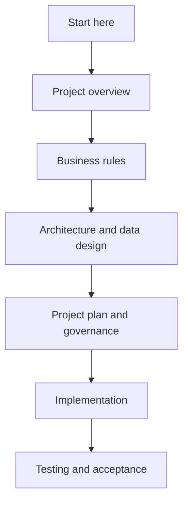
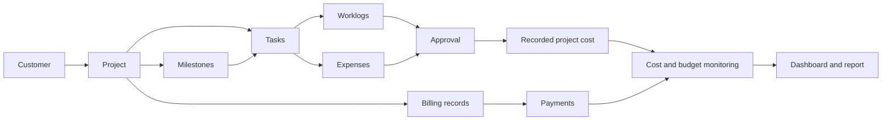
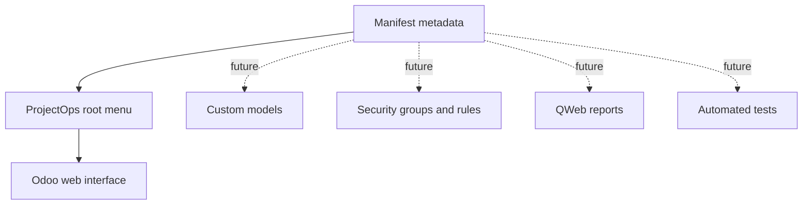

# ProjectOps Documentation

**Requirements, architecture, workflows, and delivery guidance**

[Repository README](../README.md) · [Requirements](project-overview-and-requirements.md) · [Architecture](system-architecture-and-data-design.md) · [Workflows](workflows-and-business-rules.md) · [Project plan](project-plan-and-team-governance.md)

 

> [!WARNING]
> **Documentation describes the intended system, not every implemented feature.**
>
> The current module contains metadata and a root menu only. These documents should be treated as requirements and proposed technical design until the corresponding code, views, security, and tests exist.

---

## Documentation map

| Area | Document | Primary purpose |
|:--|:--|:--|
| Product | [Project overview and requirements](project-overview-and-requirements.md) | Goals, scope, roles, requirements, and boundaries |
| Delivery | [Project plan and team governance](project-plan-and-team-governance.md) | Roadmap, responsibilities, risks, checkpoints, and handover |
| Technical | [System architecture and data design](system-architecture-and-data-design.md) | Proposed architecture, entities, relationships, and technical contracts |
| Operations | [Workflows and business rules](workflows-and-business-rules.md) | Intended workflows, approval rules, calculations, and open decisions |

---

## Reading guide

### 1. Understand the product

Begin with [Project overview and requirements](project-overview-and-requirements.md).

It defines:

- The problem ProjectOps addresses
- The intended MVP scope
- Target users and roles
- Functional and non-functional requirements
- Out-of-scope capabilities
- Project success boundaries

### 2. Understand the operating rules

Continue with [Workflows and business rules](workflows-and-business-rules.md).

It defines:

- Customer-to-project operations
- Delivery and task workflows
- Worklog and expense approvals
- Cost and billing calculations
- Project completion and health concepts
- Decisions that still require team approval

### 3. Understand the proposed technical design

Review [System architecture and data design](system-architecture-and-data-design.md).

It proposes:

- Odoo-native versus custom-model choices
- A candidate data model
- Entity relationships
- Proposed fields and constraints
- Security architecture
- Reporting and integration approaches

The native-versus-custom model decisions and module dependencies are not final.

### 4. Understand delivery and governance

Use [Project plan and team governance](project-plan-and-team-governance.md).

It covers:

- Implementation phases
- Team responsibilities
- Shared integration agreements
- Testing and handover criteria
- Delivery risks
- Scope-change controls

---

## Intended workflow

The project and financial stages remain independent: project completion does not imply that customer invoices have been settled.

---

## Implementation status

| Document status | Meaning |
|:--|:--|
| Requirements draft | Intended scope and behavior are described |
| Architecture proposal | Candidate models and relationships are proposed |
| Open decisions | Workflow, threshold, reversal, and authority details remain unresolved |
| Implemented behavior | Exists only when backed by code, views, security, and tests |

### Repository implementation

Custom business models, role-based security, approval workflows, billing, dashboards, reports, and automated tests are not currently present.

---

## Source-of-truth rule

As implementation progresses:

1. Requirements documents define intended behavior.
2. Architecture documents record agreed technical decisions.
3. Workflow documents describe approved states and rules.
4. Python and XML implement the behavior.
5. Tests verify the behavior.
6. The README communicates only verified implementation status.

If documentation and code differ, the code and tests determine the current behavior unless a repository review formally approves a documentation correction.

---

## Suggested reading paths

| If you are a | Start with |
|:--|:--|
| Product owner | [Project overview](project-overview-and-requirements.md) → [Workflows](workflows-and-business-rules.md) |
| Project manager | [Workflows](workflows-and-business-rules.md) → [Project plan](project-plan-and-team-governance.md) |
| Backend engineer | [Architecture](system-architecture-and-data-design.md) → [Business rules](workflows-and-business-rules.md) |
| Security and QA engineer | [Workflows](workflows-and-business-rules.md) → [Architecture](system-architecture-and-data-design.md) |
| UI and reporting engineer | [Architecture](system-architecture-and-data-design.md) → [Project overview](project-overview-and-requirements.md) |
| New contributor | [Repository README](../README.md) → [Project overview](project-overview-and-requirements.md) |

---

## Documentation roadmap

The following pages should be added as implementation matures:

- Installation and environment setup
- Developer setup and addons-path configuration
- Implemented data model and field reference
- Security and role-permission matrix
- User workflows
- Test plan and test execution
- Deployment and upgrade procedures
- Demo data and acceptance evidence
- Troubleshooting and known limitations

---

[Return to repository README](../README.md)

ProjectOps documentation · Keradion Technology

